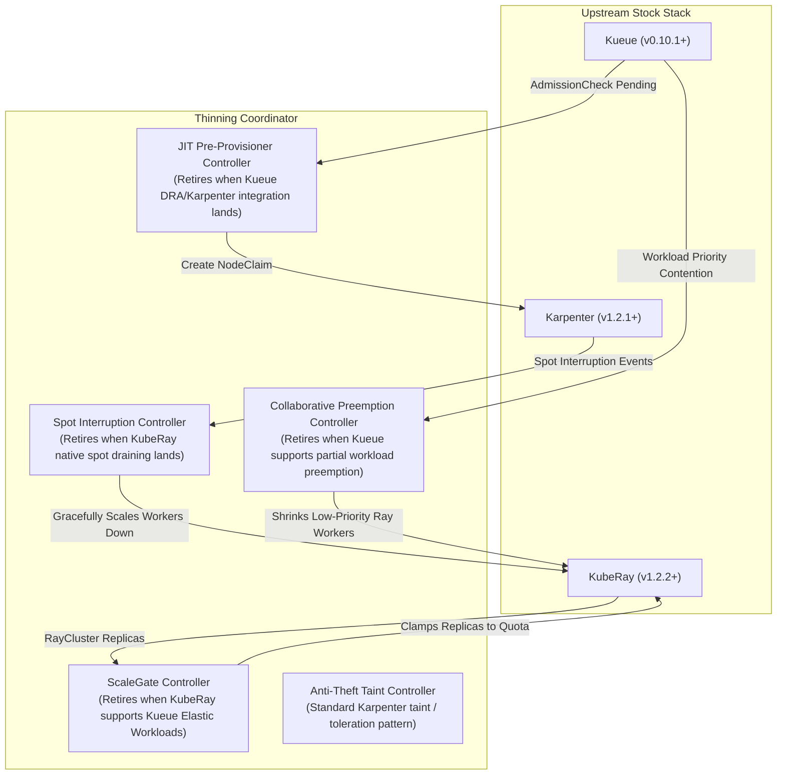

# Kubernetes Elastic Scale Lab: Karpenter + Kueue + KubeRay + DRA

A minimal-patch, reproducible testing lab and coordinator for multi-framework elastic autoscaling on Kubernetes 1.36+.

This lab implements and validates collaborative capacity-aware scheduling across **Karpenter v1.2.1+**, **Kueue v0.10+**, and **KubeRay v1.2+**, using **Chainsaw** for declarative end-to-end integration testing.

---

## 1. Problem Statement & Architecture

When running large-scale ML training and elastic data processing on Kubernetes, combining Karpenter (node autoscaler), Kueue (quota & admission engine), and KubeRay (distributed execution engine) reveals 5 fundamental architectural impedance mismatches:

1. **Cold-Start Gang Deadlock**: Kueue does not admit suspended batch workloads until nodes or quota checks are satisfied, while Karpenter only provisions nodes when it sees non-suspended unscheduled pods.
2. **Ray Autoscaler Quota Blindness**: The Ray Autoscaler scales worker replicas based on Ray cluster queue depth, completely unaware of Kueue ClusterQueue nominal quotas and borrowing limits.
3. **Destructive vs Collaborative Preemption**: Kueue's native preemption evicts entire Workloads (killing the Ray head pod, tearing down the cluster, and invalidating memory state) instead of asking the elastic RayCluster to shed workers down to available quota.
4. **Spot Interruption Ray Cluster Teardown**: Cloud spot termination notices cause indiscriminate pod eviction; if a worker is abruptly lost, Ray may fail whole workflows instead of draining workers gracefully.
5. **Anti-Theft Node Reservation**: When Karpenter provisions specialized GPU instances for a queued gang workload, unscheduled single pods can steal those nodes before the gang pods are scheduled.

### The "Thinning-Out" Coordinator Pattern

Rather than heavily forking Karpenter, Kueue, or KubeRay, this lab implements an external, non-invasive **Collaborative Coordinator** with five controllers designed to evaporate as upstream projects mature:



---

## 2. Test Scenarios (Chainsaw E2E Suite)

All scenarios are declaratively verified using Kyverno Chainsaw against a real Kind cluster:

| Scenario | Objective | Out-of-the-Box Behavior | Lab Coordinator Solution | Status |
| :--- | :--- | :--- | :--- | :--- |
| **01-cold-start-gang** | Cold-start 4-GPU gang training job with 0 initial GPU nodes. | Deadlock: Kueue waits for nodes; Karpenter waits for pods. | Preprovisioner generates JIT `NodeClaim` with Kueue `AdmissionCheck`. | **PASS** |
| **02-elastic-scaleup-quota** | RayCluster worker group attempts to scale up from 2 to 8 replicas with 4-GPU quota. | Quota violation: Ray autoscaler spawns pods that block forever in Kueue queue. | `ScaleGate` controller checks Kueue nominal quota and clamps `replicas` to 4. | **PASS** |
| **03-collaborative-preemption** | High-priority 2-GPU job arrives while 8-worker RayCluster holds all 8 GPUs. | Destruction: Kueue evicts entire RayCluster, killing head pod and losing dataset cache. | `Preemption` controller calculates quota deficit and shrinks RayCluster from 8 to 6 workers voluntarily. | **PASS** |
| **04-spot-interruption** | Node hosting a Ray worker receives a 2-minute spot termination notice. | Sudden worker failure triggers Ray actor rebuilds or cluster instability. | `SpotInterruption` controller drains the specific worker group gracefully before eviction. | **PASS** |
| **05-anti-theft-reservation** | Node claimed for specific gang workload appears in cluster. | Rogue low-priority pods land on the newly provisioned node first. | NodeClaim is provisioned with anti-theft taints; rogue pods rejected; gang pods tolerated. | **PASS** |

---

## 3. Quickstart & Verification

### Prerequisites
- `colima` (or Docker)
- `mise` (or Go 1.24+, Kind, Kubectl, Chainsaw)

### Running the Test Suite
```bash
# 1. Install toolchain
mise install

# 2. Build the coordinator
make build

# 3. Create Kind cluster and install Kueue + KubeRay
make kind-up
make install-crds

# 4. Start the coordinator in background
./bin/coordinator &

# 5. Run all Chainsaw scenarios
make test
```

---

## 4. Upstream Deprecation Roadmap

Every controller in this repository has a 1-to-1 retirement plan:

- **`Preprovisioner`**: Will be deprecated once Kueue's Dynamic Resource Allocation (DRA) or Karpenter's native AdmissionCheck driver stabilizes in v1.37+.
- **`ScaleGate`**: Will be deprecated when KubeRay issue [#1850](https://github.com/ray-project/kuberay) (Kueue Elastic Workloads protocol) lands upstream.
- **`Preemption`**: Will be replaced once Kueue provides a webhook callback allowing elastic frameworks to return partial resource yield decisions during preemption evaluation.
