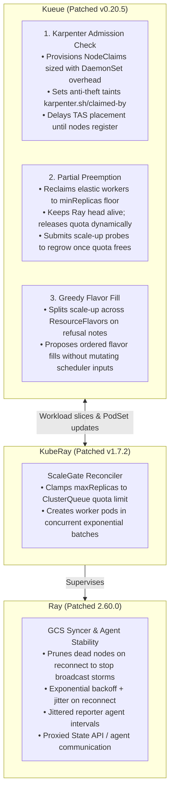

# Elastic Kueue & KubeRay Patches

[](https://github.com/simonepri/elastic-kueue-kuberay-patches/actions/workflows/ci.yaml)
[](https://github.com/simonepri/elastic-kueue-kuberay-patches/actions/workflows/release-please.yaml)
[](license)
<!-- renovate: datasource=github-releases depName=kubernetes-sigs/kueue -->
[](https://github.com/kubernetes-sigs/kueue/releases/tag/v0.20.5)
<!-- renovate: datasource=github-releases depName=ray-project/kuberay -->
[](https://github.com/ray-project/kuberay/releases/tag/v1.7.2)
<!-- renovate: datasource=github-releases depName=kubernetes-sigs/karpenter -->
[](https://github.com/kubernetes-sigs/karpenter/releases/tag/v1.15.1)
<!-- renovate: datasource=github-releases depName=interlink-hq/interLink -->
[](https://github.com/interlink-hq/interLink/releases/tag/v0.6.2)
<!-- renovate: datasource=github-releases depName=ray-project/ray -->
[](https://github.com/ray-project/ray/releases/tag/ray-2.60.0)

Production patchsets for running multi-tenant, elastic [Ray](https://github.com/ray-project/ray) clusters on Kubernetes with [Kueue](https://github.com/kubernetes-sigs/kueue), [KubeRay](https://github.com/ray-project/kuberay), and [Karpenter](https://github.com/kubernetes-sigs/karpenter).

---

## Architecture Overview

### Upstream Behavior vs. Patched Collaborative Model

In vanilla upstream Kubernetes, Kueue, KubeRay, and Karpenter operate as separate control loops without elastic coordination:

1. **All-or-Nothing Preemption**: Upstream Kueue evicts entire Ray clusters when quota is contended, killing long-running jobs rather than shrinking elastic worker pools to a floor.
2. **Quota Starvation & Scale-Up Racing**: KubeRay creates worker pods directly based on autoscaler requests without verifying ClusterQueue quota, causing unplaceable pending pods.
3. **Capacity Provisioning Gaps**: Kueue lacks native JIT node reservation for Karpenter; cold-start gangs stall, newly provisioned nodes risk being stolen by unmanaged pods, and workloads fail to fall back to secondary flavors.

With this patchset applied, the controllers collaborate dynamically:



---

## Patch Catalog

Every patch is atomic, self-contained, and tested. In each patch file, production code changes appear first, followed strictly by accompanying unit and integration tests.

### 1. Ray (`2.60.0`)
All Ray patches address core cluster stability in high-churn and multi-region environments.

| # | Patch File | Severity | Upstream Problem / Failure Mode | Solution | Validating Tests |
| :-: | :--- | :---: | :--- | :--- | :--- |
| **0001** | [`0001-fix-prune-dead-nodes-from-raylet-syncer-to-prevent-reconnect-broadcast-storms.patch`](patches/ray/0001-fix-prune-dead-nodes-from-raylet-syncer-to-prevent-reconnect-broadcast-storms.patch) | **P0 (Critical)** | Reconnecting raylet resends its full historical cluster view. GCS logs errors and rebroadcasts stale nodes to the entire fleet, causing connection storms and cluster collapse. | Implements `RemoveNode` in `RaySyncer` and `SetDeadNodeFilter` in GCS server to drop dead node updates immediately. | `src/ray/ray_syncer/tests/ray_syncer_test.cc`, `src/ray/raylet/tests/node_manager_test.cc` |
| **0002** | [`0002-fix-add-exponential-backoff-and-jitter-to-syncer-reconnect-to-prevent-thundering-herd-storms.patch`](patches/ray/0002-fix-add-exponential-backoff-and-jitter-to-syncer-reconnect-to-prevent-thundering-herd-storms.patch) | **P1 (High)** | Raylet syncer reconnects to GCS on a fixed 2.0 s timer without jitter. Hundreds of nodes losing GCS simultaneously hit in lockstep, creating a thundering-herd reconnect storm. | Adds exponential backoff with full randomized jitter between base (2 s) and max (60 s). | `src/ray/ray_syncer/tests/ray_syncer_test.cc` |
| **0003** | [`0003-fix-route-http-state-api-and-agent-calls-through-connect-proxy-to-reach-isolated-workers.patch`](patches/ray/0003-fix-route-http-state-api-and-agent-calls-through-connect-proxy-to-reach-isolated-workers.patch) | **P1 (High)** | When `RAY_grpc_enable_http_proxy` is set, gRPC connects through the proxy, but HTTP State API and job agent calls connect directly, failing for workers reachable only via HTTP CONNECT proxy. | Implements `NodeAgentConnector` in dashboard agent to route HTTP calls through the CONNECT proxy. | `python/ray/dashboard/tests/test_node_agent_proxy.py` |
| **0004** | [`0004-fix-jitter-reporter-agent-snapshot-interval-to-prevent-periodic-telemetry-spikes.patch`](patches/ray/0004-fix-jitter-reporter-agent-snapshot-interval-to-prevent-periodic-telemetry-spikes.patch) | **P2 (Medium)** | Dashboard reporter agents report node metrics every fixed 5 s, causing fleet-wide synchronized CPU and network telemetry spikes on GCS. | Adds random initial phase delay and $\pm 20\%$ randomized interval jitter. | `python/ray/dashboard/tests/test_reporter_interval_jitter.py` |

---

### 2. KubeRay Operator (`v1.7.2`)

| # | Patch File | Kind & Severity | Upstream Problem / Failure Mode | Solution | Validating Tests |
| :-: | :--- | :---: | :--- | :--- | :--- |
| **0001** | [`0001-fix-create-raycluster-worker-pods-in-concurrent-batches-to-prevent-reconciler-timeouts.patch`](patches/kuberay/0001-fix-create-raycluster-worker-pods-in-concurrent-batches-to-prevent-reconciler-timeouts.patch) | **Fix: P1 (High)** | `reconcilePods` creates missing worker pods 1-by-1 sequentially. Scaling groups with 100+ pods takes minutes and exceeds controller reconciliation timeouts. | Replaces sequential creation with concurrent batch creation in slow-start increments (1, 2, 4, 8...). | `ray-operator/controllers/ray/slow_start_batch_unit_test.go` |
| **0002** | [`0002-feat-clamp-raycluster-worker-scale-up-to-kueue-clusterqueue-quota.patch`](patches/kuberay/0002-feat-clamp-raycluster-worker-scale-up-to-kueue-clusterqueue-quota.patch) | **Feat: P0 (Essential)** | Ray autoscaler requests scale-up beyond ClusterQueue quota and cohort limits, resulting in stuck pending pods and quota starvation for other tenants. | ScaleGate reconciler inspects Kueue ClusterQueue quota and borrowing limits, clamping `maxReplicas` to available quota before pod creation. | `ray-operator/controllers/ray/scalegate_controller_unit_test.go` |

---

### 3. Kueue (`v0.20.5`)

#### Part 1: Bug Fixes (Ordered by Severity)
| # | Patch File | Severity | Upstream Problem / Failure Mode | Solution | Validating Tests |
| :-: | :--- | :---: | :--- | :--- | :--- |
| **0001** | [`0001-fix-allow-elastic-workload-scale-down-below-min-count-to-prevent-webhook-rejection.patch`](patches/kueue/0001-fix-allow-elastic-workload-scale-down-below-min-count-to-prevent-webhook-rejection.patch) | **P0 (Critical)** | Scaling down an elastic Workload below `minCount` lowers `count` but keeps `minCount`, causing the API server webhook to reject the update with *"minCount should be less or equal to count"*. Upstream: [PR #16742](https://github.com/kubernetes-sigs/kueue/pull/16742). | Caps `minCount` at the new count during scale-down; webhook accepts this reduction for elastic workloads. | `pkg/webhooks/workload_webhook_test.go`, `pkg/workload/podsetscounts_test.go` |
| **0002** | [`0002-fix-round-multi-host-worker-group-scale-up-to-whole-replica-steps-to-prevent-fractional-grants.patch`](patches/kueue/0002-fix-round-multi-host-worker-group-scale-up-to-whole-replica-steps-to-prevent-fractional-grants.patch) | **P1 (High)** | Multi-host Ray worker groups require whole replicas of `numOfHosts` pods. Partial admission can grant fractional pods (e.g. 5 pods for 2-host replicas), leading to unmatched pods and recreation loops. | Enforces whole-replica increments (`step = numOfHosts`) in scheduler reduction and ungates whole replica groups. | `pkg/scheduler/flavorassigner/podset_reducer_test.go`, `pkg/controller/elasticjobs/elastic_job_ungater_test.go` |
| **0003** | [`0003-fix-restamp-slice-and-podset-annotations-when-reapplying-ray-manifests-to-prevent-worker-gating.patch`](patches/kueue/0003-fix-restamp-slice-and-podset-annotations-when-reapplying-ray-manifests-to-prevent-worker-gating.patch) | **P1 (High)** | Re-applying a Ray manifest with `kubectl apply` replaces `workerGroupSpecs` and strips slice annotations, leaving subsequent worker pods gated indefinitely. | RayCluster defaulting webhook re-stamps PodSet label and slice name annotations from the active Workload upon update. | `pkg/controller/jobs/raycluster/elastic_template_restamp_test.go` |
| **0004** | [`0004-fix-allow-updating-queue-and-priority-on-running-deployments-via-feature-gate.patch`](patches/kueue/0004-fix-allow-updating-queue-and-priority-on-running-deployments-via-feature-gate.patch) | **P2 (Medium)** | Modifying `kueue.x-k8s.io/queue-name` or priority on active Deployments was rejected by the admission webhook when replicas were ready. | Relaxes queue and priority immutability behind the `MutableDeploymentQueue` feature gate to enable rolling updates. | `pkg/controller/jobs/deployment/deployment_webhook_test.go` |

#### Part 2: Features (Ordered by Architectural Layer)
| # | Patch File | Layer & Priority | Upstream Problem / Feature Role | Solution | Validating Tests |
| :-: | :--- | :---: | :--- | :--- | :--- |
| **0005** | [`0005-feat-add-karpenter-admission-check-to-provision-nodeclaims-for-admitted-workloads.patch`](patches/kueue/0005-feat-add-karpenter-admission-check-to-provision-nodeclaims-for-admitted-workloads.patch) | **Infrastructure (P0)** | Workloads stall waiting for reactive autoscaling; provisioned nodes lack gang reservation and are vulnerable to theft. | Karpenter AdmissionCheck controller provisions NodeClaims sized with DaemonSet overhead, hashed $\le 63$-char labels, and optimistic version locking. | `pkg/controller/admissionchecks/karpenter/controller_test.go` |
| **0006** | [`0006-feat-bind-admitted-pods-to-reserved-nodeclaims-via-anti-theft-taints-and-tolerations.patch`](patches/kueue/0006-feat-bind-admitted-pods-to-reserved-nodeclaims-via-anti-theft-taints-and-tolerations.patch) | **Placement (P0)** | Pods lack tolerations for reserved node taints (`karpenter.sh/claimed-by`) and cannot schedule once ungated. | Injects matching anti-theft tolerations and nodeSelectors directly onto admitted pods before ungating. | `pkg/controller/jobframework/karpenter_placement_test.go` |
| **0007** | [`0007-feat-delay-tas-topology-assignment-until-karpenter-nodes-register-to-prevent-unplaceable-pods.patch`](patches/kueue/0007-feat-delay-tas-topology-assignment-until-karpenter-nodes-register-to-prevent-unplaceable-pods.patch) | **Topology (P1)** | Assigning TAS topology blocks before Karpenter nodes register leads to unplaceable pods if nodes launch in different domains. | Delays TAS assignment until provisioned nodes register, with a bounded timeout fallback. | `test/integration/singlecluster/tas/tas_karpenter_test.go` |
| **0008** | [`0008-feat-inject-flavor-nodeselectors-and-tolerations-onto-pods-before-ungating.patch`](patches/kueue/0008-feat-inject-flavor-nodeselectors-and-tolerations-onto-pods-before-ungating.patch) | **Placement (P0)** | Moving an elastic PodSet across flavors mutates job templates, corrupting running workers. | Defer flavor placement to individual pods at ungate time without altering templates. | `pkg/controller/elasticjobs/elastic_flavor_placement_test.go` |
| **0009** | [`0009-feat-implement-partial-worker-stop-for-raycluster-and-rayjob-workloads.patch`](patches/kueue/0009-feat-implement-partial-worker-stop-for-raycluster-and-rayjob-workloads.patch) | **Preemption (P1)** | Preempting an elastic RayCluster evicts the entire cluster including the head pod and driver. | Implements `JobWithPartialStop` interface to stop running worker pods above target counts while preserving the head. | `pkg/controller/jobs/raycluster/partial_stop_test.go`, `pkg/controller/jobs/rayjob/partial_stop_test.go` |
| **0010** | [`0010-feat-track-workload-reclaim-targets-and-release-quota-as-stopped-workers-terminate.patch`](patches/kueue/0010-feat-track-workload-reclaim-targets-and-release-quota-as-stopped-workers-terminate.patch) | **Preemption (P1)** | Quota must be released strictly as terminated workers stop, without premature release or over-admission. | Tracks reclaim targets on Workload slices; raises `status.reclaimablePods` and releases quota as pods terminate. | `pkg/workloadslicing/partial_preemption_test.go`, `pkg/controller/elasticjobs/reclaim_targets_test.go` |
| **0011** | [`0011-feat-configure-minreplicas-floors-for-elastic-partial-preemption.patch`](patches/kueue/0011-feat-configure-minreplicas-floors-for-elastic-partial-preemption.patch) | **Preemption (P1)** | Preemption needs an explicit lower bound to know how far an elastic cluster may shrink. | Annotates Workloads with `minReplicas` floor and step size; prevents shrinking below viable cluster size. | `pkg/controller/jobs/raycluster/reclaim_floors_test.go` |
| **0012** | [`0012-feat-retry-preemption-with-topology-aware-victim-selection-to-satisfy-tas-constraints.patch`](patches/kueue/0012-feat-retry-preemption-with-topology-aware-victim-selection-to-satisfy-tas-constraints.patch) | **Topology (P2)** | Quota freed by preemption may be scattered across topology domains, causing TAS assignment to fail and aborting preemption. | Retries preemption search to free contiguous topology blocks, evicting victims whole if partial shrinking cannot fit. | `pkg/scheduler/preemption/topology_retry_test.go`, `test/integration/singlecluster/tas/tas_preemption_topology_test.go` |
| **0013** | [`0013-feat-search-and-score-victims-for-elastic-partial-preemption.patch`](patches/kueue/0013-feat-search-and-score-victims-for-elastic-partial-preemption.patch) | **Preemption (P1)** | Upstream search only considers whole-workload eviction. | Classical preemption strategy searches candidate victims shrunk to floor first, growing back in steps during fill-back. | `pkg/scheduler/preemption/partial_preemption_test.go` |
| **0014** | [`0014-feat-regrow-partially-preempted-workloads-via-scale-up-probes.patch`](patches/kueue/0014-feat-regrow-partially-preempted-workloads-via-scale-up-probes.patch) | **Preemption (P1)** | Shrunk clusters remain at their floor indefinitely after preemptor jobs complete. | Submits scale-up probes to regrow shrunk workloads to requested size once higher-priority jobs release quota. | `pkg/workloadslicing/regrow_after_reclaim_test.go`, `pkg/scheduler/regrow_after_reclaim_test.go` |
| **0015** | [`0015-feat-split-scale-up-across-flavors-into-sub-group-podsets.patch`](patches/kueue/0015-feat-split-scale-up-across-flavors-into-sub-group-podsets.patch) | **Multi-Flavor (P2)** | Elastic growth is pinned to the flavor of the first pod; exhausted flavors stall scale-up even when other flavors have capacity. | Splits elastic worker groups into sub-group PodSets upon scheduler refusal, allowing independent flavor assignment across flavors. | `pkg/scheduler/flavorassigner/flavor_split_test.go`, `pkg/workloadslicing/flavor_split_test.go` |
| **0016** | [`0016-feat-fill-flavors-in-order-when-splitting-elastic-scale-up.patch`](patches/kueue/0016-feat-fill-flavors-in-order-when-splitting-elastic-scale-up.patch) | **Multi-Flavor (P2)** | Elastic scale-up probes leave quota on earlier flavors unused when the full count only fits on later flavors. | Refusal-driven greedy fill: scheduler emits refusal notes on primary flavor, allowing scale-up to spill onto secondary flavors in priority order. | `pkg/scheduler/flavorassigner/greedy_split_test.go`, `pkg/workloadslicing/greedy_split_test.go` |

---

### 4. InterLink Virtual Kubelet (`0.6.2`)

| # | Patch File | Kind & Severity | Upstream Problem / Failure Mode | Solution | Validating Tests |
| :-: | :--- | :--- | :--- | :--- | :--- |
| **0001** | [`0001-fix-guard-terminated-reason-nil-dereference-in-check-pods-status.patch`](patches/interlink/0001-fix-guard-terminated-reason-nil-dereference-in-check-pods-status.patch) | **Fix: P0 (Critical)** | Virtual kubelet crashes with nil pointer dereference when checking pods status on failed remote containers. | Adds nil guard before accessing terminated container status reasons. | `pkg/virtualkubelet/execute_terminated_reason_test.go` |
| **0002** | [`0002-fix-route-container-status-updates-to-matching-container-name.patch`](patches/interlink/0002-fix-route-container-status-updates-to-matching-container-name.patch) | **Fix: P1 (High)** | Container status updates are incorrectly overwritten by mismatched container names. | Matches container status by exact container name before applying updates. | `pkg/virtualkubelet/execute_container_status_test.go` |
| **0003** | [`0003-feat-forward-image-pull-secrets-to-plugin-in-create-request.patch`](patches/interlink/0003-feat-forward-image-pull-secrets-to-plugin-in-create-request.patch) | **Feat: P1 (High)** | Image pull secrets are not forwarded in container create requests to remote providers. | Serializes and forwards pod imagePullSecrets in the provider create payload. | `pkg/virtualkubelet/execute_image_pull_secrets_test.go` |
| **0004** | [`0004-feat-resolve-downward-api-env-fieldrefs-for-node-topology-labels.patch`](patches/interlink/0004-feat-resolve-downward-api-env-fieldrefs-for-node-topology-labels.patch) | **Feat: P1 (High)** | Downward API environment variables referencing node labels and topology are unresolved. | Resolves downward API fieldRefs for node topology and labels before dispatching pods. | `pkg/virtualkubelet/execute_env_fieldref_test.go` |
| **0005** | [`0005-feat-report-remote-pod-ip-from-plugin-status-response.patch`](patches/interlink/0005-feat-report-remote-pod-ip-from-plugin-status-response.patch) | **Feat: P2 (Medium)** | Remote pod IP addresses reported by provider plugins are dropped from status. | Extracts remote pod IP from provider status response and populates PodStatus.PodIP. | `pkg/virtualkubelet/execute_pod_ip_test.go` |

---

## Development & Testing Workflow

This repository uses [`mise`](https://mise.jdx.dev) to manage dependencies and task automation.

### Prerequisites
- Go 1.27+
- Docker or Colima
- `mise`

### Core Tasks

```bash
# Apply patches to upstreams
mise run patch:kueue
mise run patch:kuberay
mise run patch:interlink
mise run patch:ray
mise run patch                # Applies all patches

# Run unit and integration tests
mise run test:interlink       # Patched interLink unit tests
mise run test:kuberay         # Patched KubeRay unit tests (with race detector)
mise run test:kueue           # Patched Kueue unit tests (with race detector)
mise run test:kueue-integration # Patched Kueue Ginkgo integration suites against envtest
mise run test:checks          # Static RBAC and topology bounds checks

# Build patched images
mise run build:kueue
mise run build:kuberay
mise run build:interlink
mise run build:ray
mise run build                # Builds all container images
```

---

## Feature Gates Reference

When deploying patched Kueue, enable the following feature gates in your `Configuration` or Helm `values.yaml`:

```yaml
controllerManager:
  featureGates:
    - name: ConcurrentAdmission
      enabled: true
    - name: ElasticJobsViaWorkloadSlicesFlavorChangeFromZero
      enabled: true
    - name: ElasticJobsViaWorkloadSlicesWithPartialReplicaScaleUp
      enabled: true
    - name: ElasticJobsViaWorkloadSlicesFlavorSplit
      enabled: true
    - name: PartialPreemption
      enabled: true
    - name: TopologyAwareScheduling
      enabled: true
```

---

## License

This repository is licensed under the Apache 2.0 License. See [LICENSE](license) for details.
